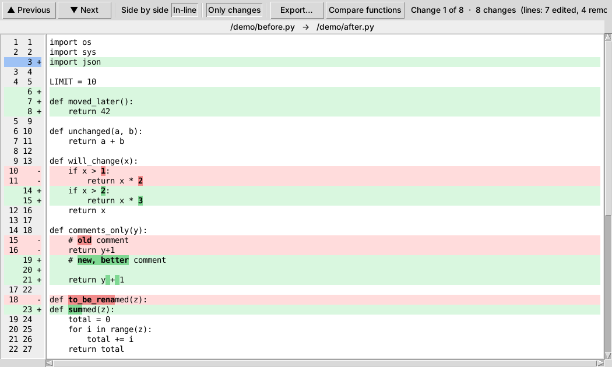
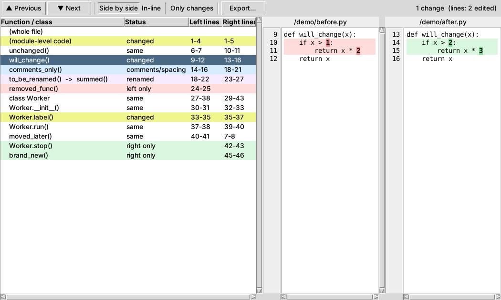

# pydiff - A Minimalistic Difflib GUI

A simple desktop app for comparing two text files, or two folders, side by side or in-line, with the differences highlighted. It also has a **function-by-function comparison mode for Python files** and **git integration**.

This is a modified version of [pydiff](https://github.com/yelsayd/pydiff) by Yasser Elsayed. It fixes a number of bugs and adds many features: function-level comparison, a faster comparison engine, an in-line view, change navigation, export, git integration and a one-click Windows launcher. See [CHANGES.md](CHANGES.md) for exactly what changed and why.






---

## What you need

- **Python 3.8 or newer**, from [python.org](https://www.python.org/downloads/).
  When installing on Windows, tick **"Add python.exe to PATH"**. Also leave **"tcl/tk and IDLE"** selected (it is by default), because pydiff's window toolkit, Tkinter, comes from there.
- No other packages. pydiff uses only the Python standard library.
- *Optional:* [git](https://git-scm.com/downloads), for the Git menu.

## Getting it

Either:

- **Download ZIP:** click the green **Code** button on this page, then **Download ZIP**, and unzip it anywhere, or
- **Clone with git:** `git clone https://github.com/Constantinos999/pydiff.git`

Everything pydiff needs is included either way.

## Running it

### Windows: one click

Double-click **`Run_PyDiff.bat`**. It:

1. finds Python on your PC (the newest 3.8+ installed; it offers to install Python if there isn't one),
2. checks that everything pydiff needs is present and fixes anything missing,
3. opens pydiff without leaving a command window open.

**Shortcut:** drag two files, or two folders, onto `Run_PyDiff.bat` to compare them straight away.

### Any system: command line

```
python pydiff.py                          # open empty, then use the File menu
python pydiff.py old.py new.py            # compare two files
python pydiff.py old_folder new_folder    # compare two folders
python pydiff.py -f old.py new.py         # also open the function-by-function view
python pydiff.py --check-deps             # just check the dependencies
```

(On macOS/Linux use `python3` instead of `python`.)

## Using it

### The toolbar

| Button | What it does |
|---|---|
| **▲ Previous / ▼ Next** | jump to the previous / next change (also **Alt+Up / Alt+Down**). The status text shows e.g. *"Change 3 of 12"*, and the line numbers of that change are highlighted in blue |
| **Side by side / In-line** | two panes, or one pane with each removed line (red, `-`) shown above its replacement (green, `+`), like GitHub |
| **Only changes** | hides unchanged stretches, keeping a few lines of context around each change. Set how many under *View → Lines of Context Around Changes* |
| **Export…** | save the comparison as an **HTML report** (opens in any web browser; matches the current view) or a standard **.diff / .patch** file (also **Ctrl+E**) |
| **Compare functions** | the function-by-function view for Python files (also **Ctrl+K**) |

The status text on the right summarises the differences, e.g. *"5 changes (lines: 3 edited, 1 removed, 4 added)"*. It also notes when the files use a different **encoding** (e.g. UTF-8 vs UTF-16) or different **line endings** (Windows CRLF vs Unix LF).

Your choices (view mode, *Only changes*, context lines, *Start maximised*) are remembered for next time.

### Comparing two files

**File → Compare Files** (**Ctrl+O**): pick the left file, then the right file.

| Colour | Meaning |
|---|---|
| Red (left) | line removed, or changed |
| Green (right) | line added, or changed |
| **Bold, darker red/green** | the exact characters that changed within a line |
| Grey | filler, so matching lines stay side by side |

Both panes scroll together. Line numbers are each file's real line numbers.

**Which files work?** Any plain-text file: code in any language, `.txt`, `.csv`, `.log`, `.ini`, `.md`, `.html`, `.json` and so on. Encodings are detected automatically: UTF-8, UTF-16 (e.g. Windows registry exports, some PowerShell output) and Windows ANSI/ASCII. For files that aren't text (images, PDFs, Word documents), pydiff tells you whether the two files are identical or different, rather than showing gibberish.

### Comparing two folders

**File → Compare Directories**: pick the left folder, then the right folder. The tree on the left shows every file and folder:

| Colour | Meaning |
|---|---|
| Red | only in the left folder |
| Green | only in the right folder |
| Yellow | in both, but different |
| Blue | in both; only the line endings differ (Windows vs Unix). Switch this off under *View → Folders: Ignore Line-Ending-Only Differences* to show them as yellow |
| Purple | a folder that contains differences somewhere inside |
| White | identical |

Click a file in the tree to see its comparison.

### Comparing Python files function by function

**File → Compare Functions (Python)**, **Ctrl+K**, or the **Compare functions** button.

Line-by-line comparison gets confusing when functions have been moved around, renamed, or only had their comments tidied. This mode reads both files as Python code, matches every function, class and method **by name**, and lists them with a status:

| Status | Colour | Meaning |
|---|---|---|
| same | white | identical |
| comments/spacing | blue | only comments, blank lines or spacing differ; the code is the same |
| changed | yellow | the code is different |
| renamed | purple | same code under a different name (e.g. `old_name() -> new_name()`) |
| left only | red | removed in the right file |
| right only | green | added in the right file |

- Click an entry to see the diff of **just that function**, with its real line numbers in each file. The toolbar (next/previous, in-line, only changes, export) works here too.
- **(whole file)** shows the normal full comparison; **(module-level code)** covers imports, constants and other code outside functions.
- **View → List: Only Differences** hides everything marked *same*.
- The window title gives a summary, e.g. *"3 changed, 1 renamed, 5 same"*.

This mode needs files that are valid **Python 3** code. For anything else, use the normal comparison.

### Git integration

The **Git** menu (needs [git](https://git-scm.com/downloads) installed):

- **Compare File With Last Commit** (**Ctrl+L**): pick a file in a git repository, and see what you've changed since your last commit.
- **Compare File With Commit…**: the same, against any commit, branch or tag (e.g. `HEAD~1` = the commit before last, `main`, `v1.0`).
- **Use pydiff as Git's Diff Viewer…**: registers pydiff with git, after asking you first. Then, in any repository:
  - `git difftool` compares each changed file in pydiff,
  - `git difftool -d` compares the whole folder at once,
  - `git difftool HEAD~1` compares with the commit before last.

  Your normal `git diff` is not affected.

### Keyboard shortcuts

| Keys | Action |
|---|---|
| Ctrl+O | compare files |
| Alt+Down / Alt+Up | next / previous change |
| Ctrl+F | find text (Enter or F3 for the next match, Esc to close) |
| Ctrl+G | go to line (of the left file) |
| Ctrl+K | compare functions |
| Ctrl+E | export results |
| Ctrl+L | compare with last git commit |
| Ctrl+C | copy selected text |

### Start maximised

**View → Start Maximised** makes pydiff open full-screen every time.

## If something goes wrong

- Error messages appear in a pop-up. If pydiff crashes, the details are saved to `pydiff_error.log` in the pydiff folder. Please include that file if you open an issue.
- **"Tkinter is missing"**: run the Python installer again, choose *Modify*, and tick *tcl/tk and IDLE*.
- **Nothing happens when double-clicking `Run_PyDiff.bat`**: open a command prompt in the pydiff folder and run `python pydiff.py --check-deps` to see the message.
- Your settings are kept in `.pydiff_settings.json` in your home folder. Delete it to go back to the defaults.

## Credits and licence

- Original pydiff and difflibparser: **Yasser Elsayed** (2016).
- Bug fixes, new comparison engine, function comparison, git integration, export, views and Windows launcher: **Constantinos999** (2026). See [CHANGES.md](CHANGES.md).

Released under the **MIT License**, the same licence as the original. See [LICENSE](LICENSE). You're free to use, modify and share it, as long as the copyright notices and licence text are kept.
