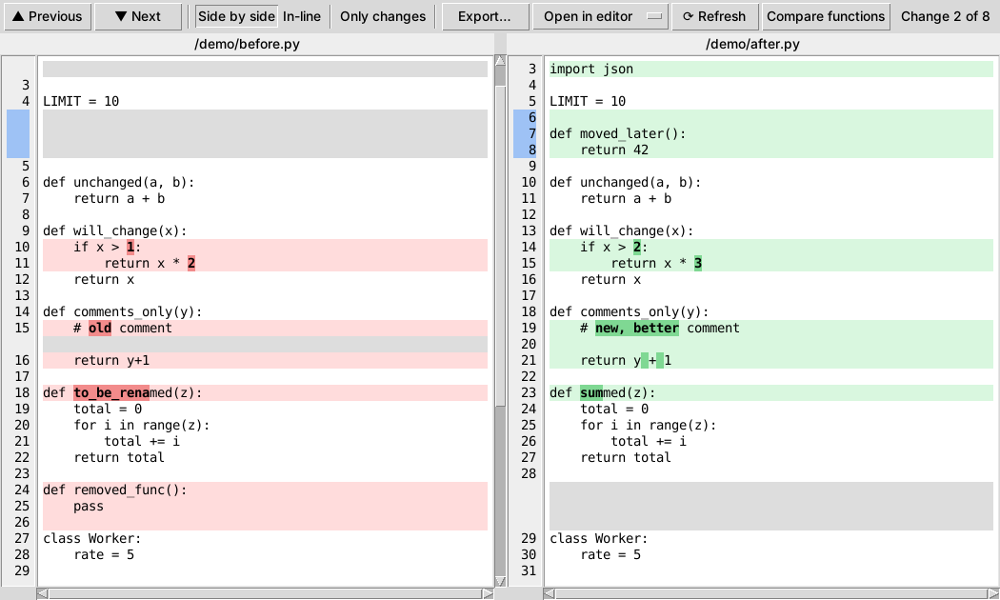

# pydiff - A Minimalistic Difflib GUI

A simple desktop app for comparing two text files, or two folders, side by side, with the differences highlighted. It also has a **function-by-function comparison mode for Python files**.

This is a modified version of [pydiff](https://github.com/yelsayd/pydiff) by Yasser Elsayed. It fixes a number of bugs, adds function-level comparison and adds a one-click Windows launcher. See [CHANGES.md](CHANGES.md) for exactly what changed and why.




---

## What you need

- **Python 3.8 or newer**, from [python.org](https://www.python.org/downloads/).
  When installing on Windows, tick **"Add python.exe to PATH"**. Also leave **"tcl/tk and IDLE"** selected (it is by default), because pydiff's window toolkit, Tkinter, comes from there.
- No other packages. pydiff uses only the Python standard library.

## Getting it

Either:

- **Download ZIP:** click the green **Code** button on this page, then **Download ZIP**, and unzip it anywhere, or
- **Clone with git:** `git clone https://github.com/YOUR-USERNAME/pydiff.git`

Everything pydiff needs is included either way.

## Running it

### Windows: one click

Double-click **`Run_PyDiff.bat`**. It:

1. finds Python on your PC (and offers to install it if there isn't one),
2. checks that everything pydiff needs is present and fixes anything missing,
3. opens pydiff without leaving a command window open.

**Shortcut:** drag two files, or two folders, onto `Run_PyDiff.bat` to compare them straight away.

### Any system: command line

```
python pydiff.py                          # open empty, then use the File menu
python pydiff.py old.py new.py            # compare two files
python pydiff.py old_folder new_folder    # compare two folders
python pydiff.py -f old.py new.py         # also open the function-by-function view
python pydiff.py --check-deps             # just check the dependencies
```

(On macOS/Linux use `python3` instead of `python`.)

## Using it

### Comparing two files

**File → Compare Files**: pick the left file, then the right file.

| Colour | Meaning |
|---|---|
| Red (left) | line removed, or changed |
| Green (right) | line added, or changed |
| **Bold, darker red/green** | the exact characters that changed within a line |
| Grey | filler, so matching lines stay side by side |

Both panes scroll together. Line numbers are each file's real line numbers.

### Comparing two folders

**File → Compare Directories**: pick the left folder, then the right folder. The tree on the left shows every file and folder:

| Colour | Meaning |
|---|---|
| Red | only in the left folder |
| Green | only in the right folder |
| Yellow | in both, but different |
| Purple | a folder that contains differences somewhere inside |
| White | identical |

Click a file in the tree to see its comparison.

### Comparing Python files function by function

**File → Compare Functions (Python)**, or **Ctrl+K**.

Line-by-line comparison gets confusing when functions have been moved around, renamed, or only had their comments tidied. This mode reads both files as Python code, matches every function, class and method **by name**, and lists them with a status:

| Status | Colour | Meaning |
|---|---|---|
| same | white | identical |
| comments/spacing | blue | only comments, blank lines or spacing differ; the code is the same |
| changed | yellow | the code is different |
| renamed | purple | same code under a different name (e.g. `old_name() -> new_name()`) |
| left only | red | removed in the right file |
| right only | green | added in the right file |

- Click an entry to see the diff of **just that function**, with its real line numbers in each file.
- **(whole file)** shows the normal full comparison; **(module-level code)** covers imports, constants and other code outside functions.
- **View → Show only differences** hides everything marked *same*.
- The window title gives a summary, e.g. *"3 changed, 1 renamed, 5 same"*.

This mode needs files that are valid **Python 3** code. For anything else, use the normal comparison.

### Keyboard shortcuts

| Keys | Action |
|---|---|
| Ctrl+F | find text (Enter or F3 for the next match, Esc to close) |
| Ctrl+G | go to line |
| Ctrl+K | compare functions |
| Ctrl+C | copy selected text |

## If something goes wrong

- Error messages appear in a pop-up. If pydiff crashes, the details are saved to `pydiff_error.log` in the pydiff folder. Please include that file if you open an issue.
- **"Tkinter is missing"**: run the Python installer again, choose *Modify*, and tick *tcl/tk and IDLE*.
- **Nothing happens when double-clicking `Run_PyDiff.bat`**: open a command prompt in the pydiff folder and run `python pydiff.py --check-deps` to see the message.

## Credits and licence

- Original pydiff and difflibparser: **Yasser Elsayed** (2016).
- Bug fixes, function comparison and Windows launcher: **Constantinos999** (2026). See [CHANGES.md](CHANGES.md).

Released under the **MIT License**, the same licence as the original. See [LICENSE](LICENSE). You're free to use, modify and share it, as long as the copyright notices and licence text are kept.
